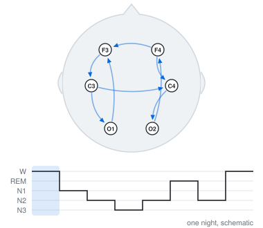
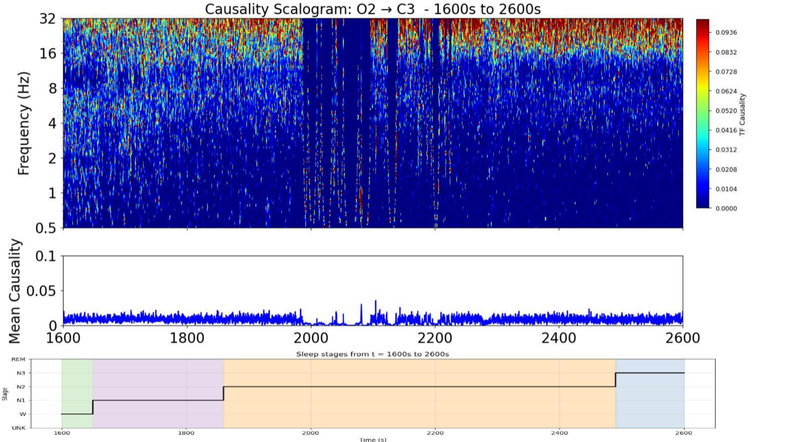

# Time-frequency Granger causality in sleep EEG

<picture>
  <source media="(prefers-color-scheme: dark)" srcset="assets/granger-dark.svg">
  
</picture>

How do brain regions drive each other during sleep, and how does that change from one stage to the next? This project builds a time-frequency version of Granger causality to follow directed interactions between EEG channels over a whole night, instead of averaging them over long stationary windows.

Research project at École des Ponts (November 2024 to August 2025), with researchers from CNRS (LOMA, Bordeaux) and the Max Planck Institute for the Physics of Complex Systems (Dresden).

**Louis Almairac**, Alexandre André, Matthieu Pascal, Alexandre Guillet, Françoise Argoul, Pierre Argoul

## Outputs

- **Poster** at the 4th International Summer Institute on Network Physiology (ISINP 2025), Lake Como School of Advanced Studies, July 2025 · [POSTER.pdf](POSTER.pdf)

## Data

Full-night polysomnography from the PhysioNet 2018 Challenge (MGH Sleep Lab), with sleep stages scored every 30 s. The analysis uses six EEG channels (F3, F4, C3, C4, O1, O2); the other signals (EOG, EMG, ECG, respiration, SaO2) are kept as references.

## Method

- **Preprocessing**: band-pass 0.1-40 Hz, 50 Hz notch, robust whitening and artefact removal, 40 s segments kept only if they pass ADF and KPSS stationarity tests.
- **VAR models** of order 20, chosen with AIC and BIC.
- **Granger causality** in time (prediction-error reduction) and in frequency (Geweke decomposition), with directional, instantaneous and total causality.
- **Time-frequency causality**: a Morlet continuous wavelet transform and a Cholesky factorisation of the spectral density matrix give a causality value at each time and frequency. Validated on simulated VAR(3) processes, where couplings in the 10-40 Hz range are located within about 0.1 s.

## A result

  

Causality from O2 to C3 over 1000 s, from wake to deep sleep. Directed influence is not continuous: it comes in short bursts concentrated in specific frequency bands, and its level changes with the sleep stage. In deep sleep (N3), the averaged spectra show a coupling peak around 11 Hz, in the sigma band of sleep spindles.

## Limits and next steps

The wavelet parameters trade time resolution against frequency resolution and still need tuning, and the method is sensitive to residual artefacts. Natural extensions are non-linear causality (kernel or recurrent models) and a GPU implementation for whole-night, all-channel analysis.

The figure at the top is a schematic; the result above is from the data.
